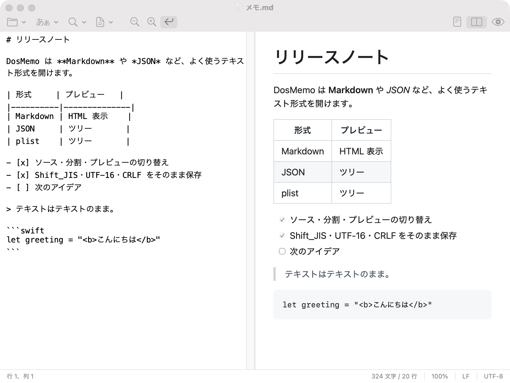
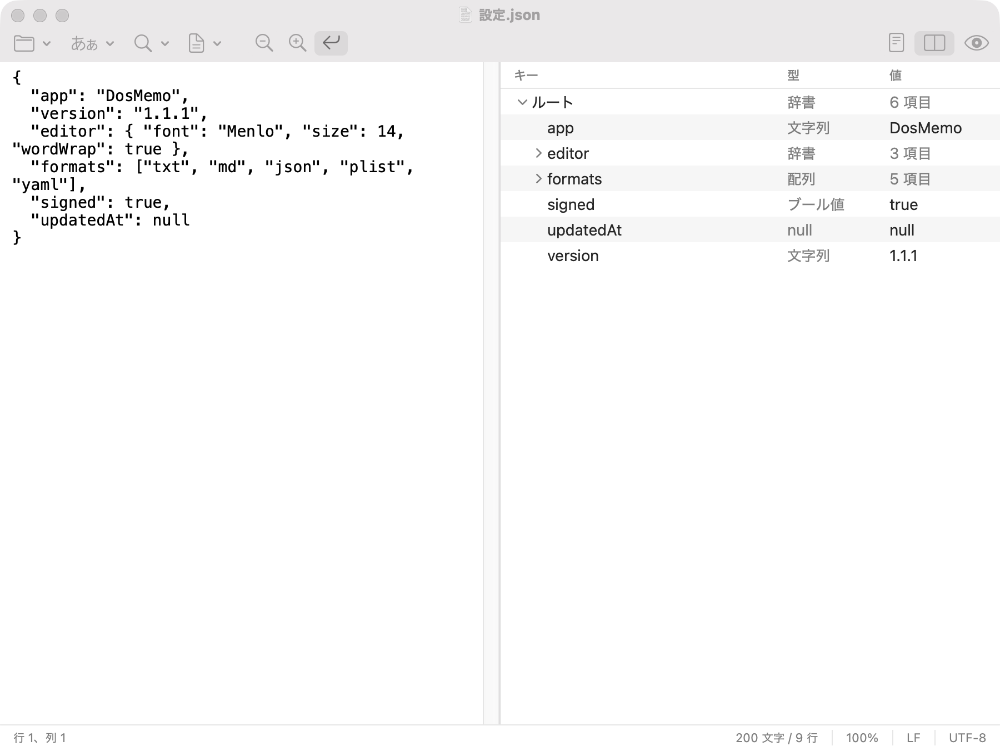
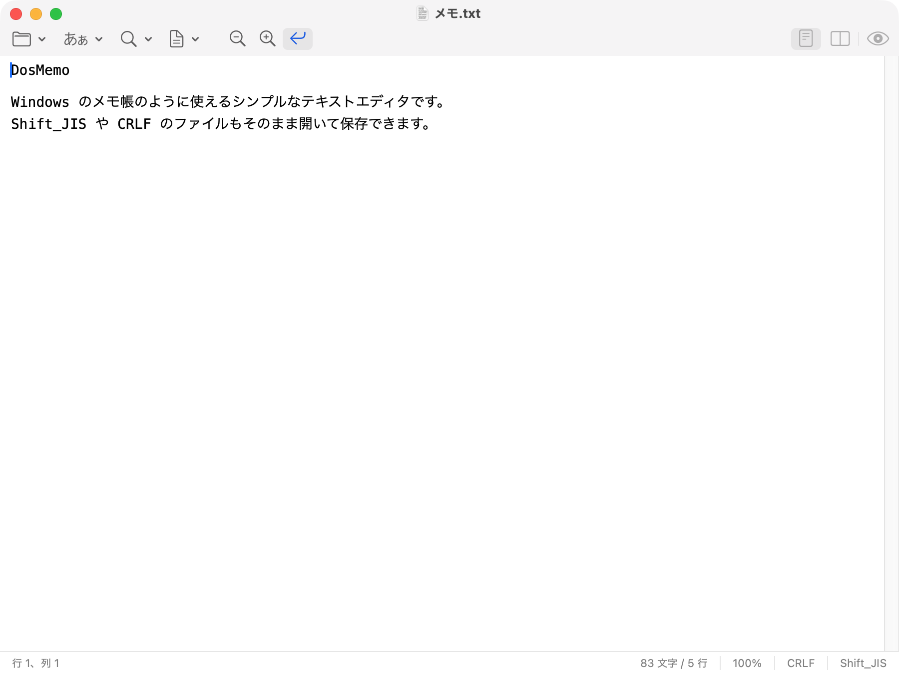

# DosMemo

[English](README.md)

Windows のメモ帳のように使える、macOS 13 以降向けの軽量テキストエディタです。



## 機能

- **Markdown プレビュー** — GitHub Flavored Markdown(表・チェックリスト・取り消し線・コードブロック)。ライト/ダークモード対応。
- **JSON / plist のツリー表示** — キー・型・値を折りたたみ表示。構文エラーは行と列を表示。

  

- **ソース / 分割 / プレビュー** — ツールバーまたは「表示」メニュー(⌥⌘1〜3)。
- **文字コード・改行コードを保持** — UTF-8、UTF-16、Shift_JIS、EUC-JP / LF、CRLF、CR。

  

- **対応形式** — txt、md、json、yaml、xml、plist(バイナリ plist は XML で編集してバイナリで保存)、html、css、js、sh、py、csv、tsv、toml、ini、conf、log、ソースコード。
- **Dock メニュー** — Dock アイコンから「新規作成」「開く…」。
- **言語** — 日本語、英語、フランス語、ドイツ語。

## インストール

[Releases](https://github.com/otti83/DosMemo/releases) から DMG をダウンロードし、DosMemo を「アプリケーション」へドラッグしてください。

## ビルド

Xcode または Swift 5.9 以降のツールチェーンが必要です。

```sh
bash test.sh            # ユニットテスト
bash build.sh release   # ~/Library/Caches/com.dosmemo.build/app/DosMemo.app を作成
bash release.sh         # 署名・公証済みの DMG を dist/ に作成
```

- ビルド成果物は `~/Library/Caches/com.dosmemo.build`(`DOSMEMO_BUILD_DIR` で変更可)に置きます。ネットワークドライブ上では SwiftPM のビルドとコード署名が失敗するためです。
- 署名は `Developer ID Application` → `Apple Development` → アドホックの順に選びます。`DOSMEMO_SIGN_IDENTITY` で指定できます(`-` でアドホック)。
- `release.sh` は、署名が Developer ID で、キーチェーンに `dosmemo-notary` プロファイル(`xcrun notarytool store-credentials dosmemo-notary`)があるときに公証します。プロファイル名は `DOSMEMO_NOTARY_PROFILE` で変更できます。
- 翻訳は `Resources/*.lproj` にあり、`build.sh` が `Contents/Resources` にコピーします。

## 謝辞

- Markdown 変換: [swift-cmark](https://github.com/swiftlang/swift-cmark)(cmark-gfm)
- 表示スタイル: [github-markdown-css](https://github.com/sindresorhus/github-markdown-css)(MIT、`Resources/markdown/`)
