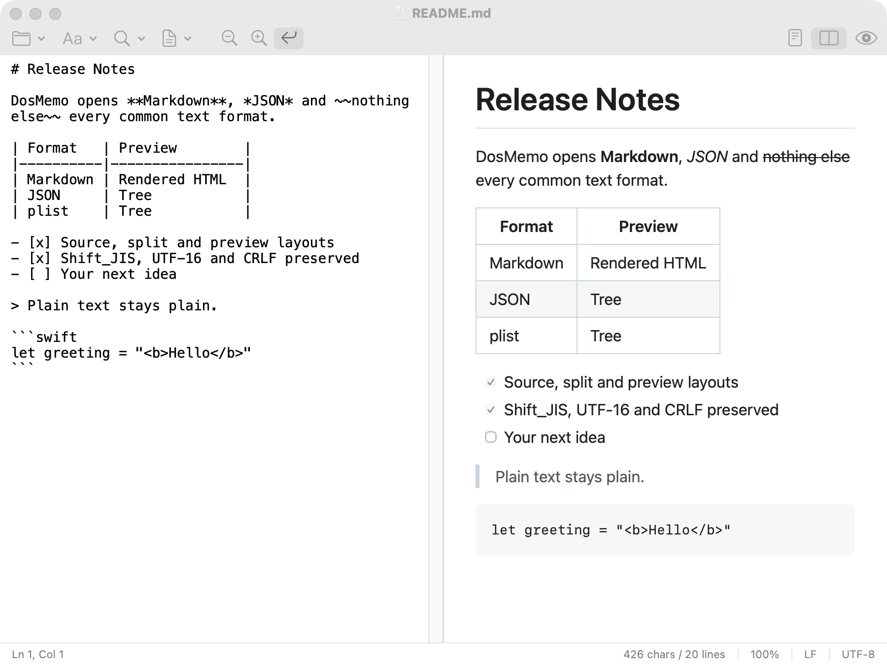
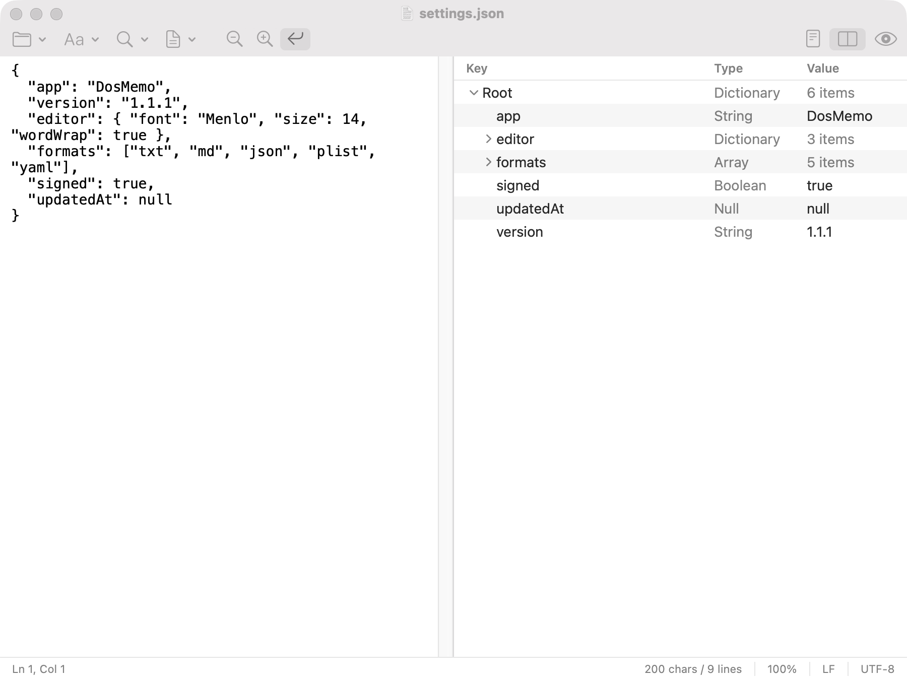
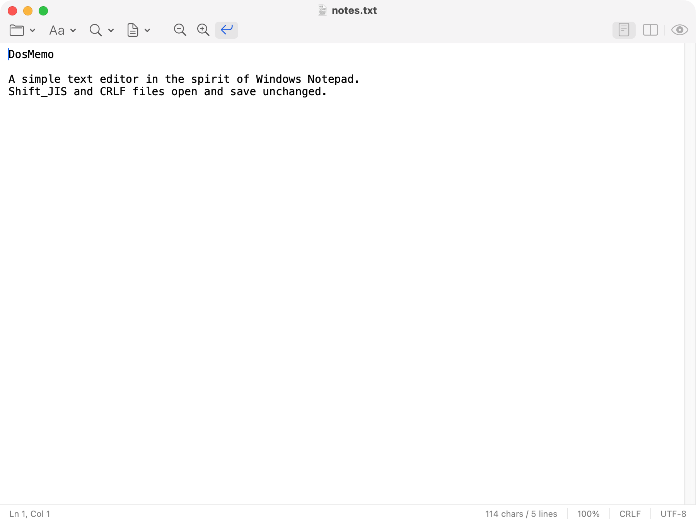

# DosMemo

[日本語](README.ja.md)

A lightweight text editor for macOS 13 or later, in the spirit of Windows Notepad.



## Features

- **Markdown preview** — GitHub Flavored Markdown: tables, task lists, strikethrough, code blocks. Follows light and dark mode.
- **JSON / plist tree** — keys, types and values in a collapsible tree. Syntax errors show the line and column.

  

- **Source / Split / Preview** — toolbar or View menu (⌥⌘1–3).
- **Encodings and line endings kept** — UTF-8, UTF-16, Shift_JIS, EUC-JP; LF, CRLF, CR.

  

- **Text formats** — txt, md, json, yaml, xml, plist (binary plists are edited as XML and saved as binary), html, css, js, sh, py, csv, tsv, toml, ini, conf, log, source code.
- **Dock menu** — New and Open from the Dock icon.
- **Languages** — English, Japanese, French, German.

## Install

Download the DMG from [Releases](https://github.com/otti83/DosMemo/releases) and drag DosMemo to Applications.

## Build

Requires Xcode or a Swift 5.9+ toolchain.

```sh
bash test.sh            # unit tests
bash build.sh release   # ~/Library/Caches/com.dosmemo.build/app/DosMemo.app
bash release.sh         # signed, notarized DMG in dist/
```

- Build products go to `~/Library/Caches/com.dosmemo.build` (override with `DOSMEMO_BUILD_DIR`); SwiftPM builds and code signing fail on network volumes.
- Signing picks `Developer ID Application`, then `Apple Development`, then ad-hoc. Override with `DOSMEMO_SIGN_IDENTITY` (`-` for ad-hoc).
- `release.sh` notarizes when the identity is Developer ID and the `dosmemo-notary` keychain profile exists (`xcrun notarytool store-credentials dosmemo-notary`). Override the profile with `DOSMEMO_NOTARY_PROFILE`.
- Localizations are in `Resources/*.lproj`; `build.sh` copies them into `Contents/Resources`.

## Acknowledgements

- [swift-cmark](https://github.com/swiftlang/swift-cmark) (cmark-gfm) for Markdown
- [github-markdown-css](https://github.com/sindresorhus/github-markdown-css) (MIT, `Resources/markdown/`)
